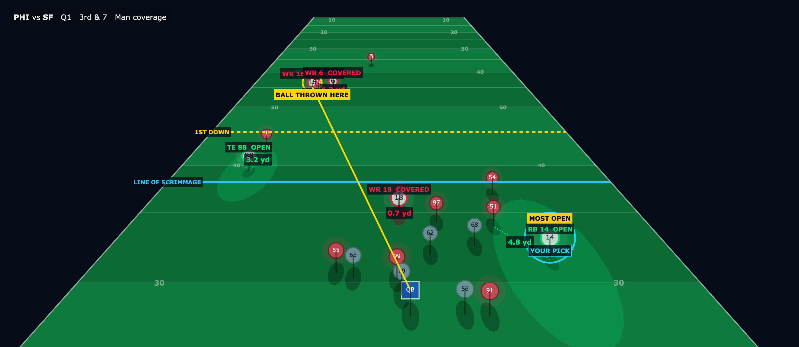
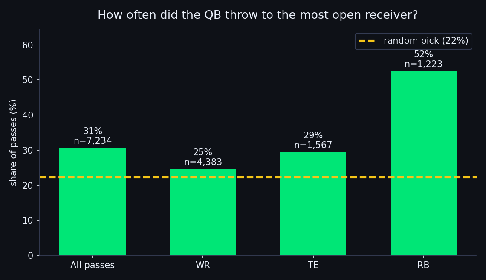
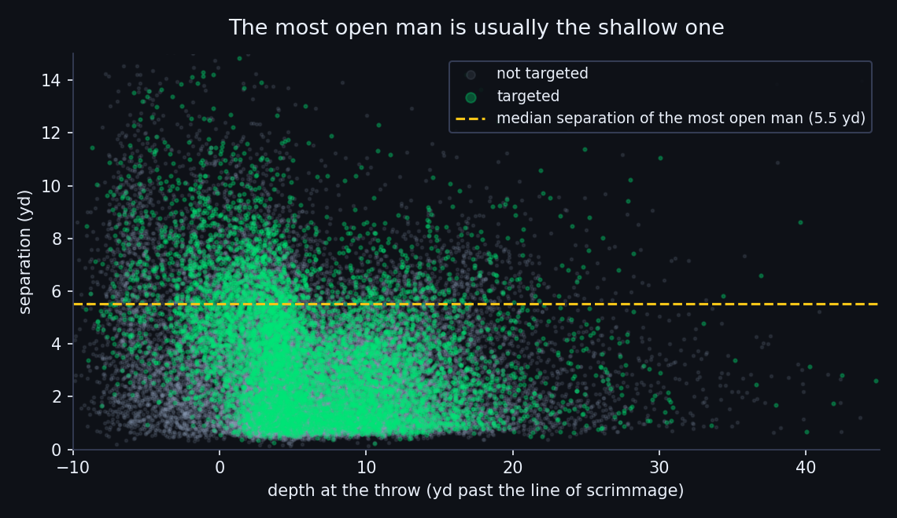

# Be the QB — who was open at the throw?

**Be the QB** freezes a real NFL play at the exact frame the ball left the quarterback's hand, hides the ball, and asks you the only question that matters at that instant: *who do you throw to?* The reveal then shows the space every eligible receiver (WR / TE / RB) actually had — distance to his nearest defender — plus the man the QB chose and what happened. Measured over **7,234 pass attempts** (2021, weeks 1–8), NFL quarterbacks threw to the **most open** receiver **31%** of the time, against **22%** if the choice were random: the targeted man had **3.3 yd** of separation versus **2.6 yd** for the options left behind. The split by position is the real story — when a **RB** is the most open man he gets the ball **52%** of the time, a **WR** only **25%**, because the biggest gap is usually the shallowest one. Useful for a broadcaster explaining a throw in five seconds, for fan engagement as a second-screen game, and for a scout who wants separation in context instead of a single season average.

Unlike the Next Gen Stats "average separation", which only measures the targeted receiver, this measures **every** option at the throw, so the QB's decision is compared with the alternatives he actually had.







## How to run

```bash
pip install -r requirements.txt && streamlit run app.py
```

The app only reads the committed files in `data/processed/`, so it runs from a clean clone. To regenerate everything from the raw tracking data (downloads ~850 MB into `data/raw/`, which is git-ignored):

```bash
python src/build_dataset.py && python src/analysis.py
```

## Method

- Pass attempts only (`passResult` C / I / IN); sacks and scrambles are excluded.
- The throw is the first frame tagged `pass_forward` or `autoevent_passforward`; only that frame is kept.
- Plays running left are mirrored (`x = 120 - x`, `y = 53.3 - y`) so the offense always attacks `+x`.
- Options are offensive players with PFF `pff_role == 'Pass Route'`; defenders are every player of the defensive team. `separation` = distance to the nearest defender, `depth` = `x - los_x`.
- The targeted receiver is parsed out of `playDescription` ("… to C.Lamb") and matched by last name to exactly one route runner; plays without a unique match are dropped (95.7% of attempts match).
- Guards in the pipeline: unique-target rate ≥ 90%, QB behind the line of scrimmage on ≥ 95% of plays (measured 100%), mean options per play in [3, 6] (measured 4.63).

## Assumptions and limits

- **The tracking stops 5 frames (0.5 s) after the throw**, so the catch, the yards after catch and the tackle are not measurable in this dataset. Everything here is measured at the release, not at the arrival.
- Separation is a geometric distance at one instant. It says nothing about throwing windows, closing speed, leverage or the coverage responsibility of a defender — a wide-open man is not always a possible throw, and this project never claims the QB should have thrown elsewhere.
- The targeted receiver comes from the text description, not from a dedicated column, so about 4% of attempts are dropped.
- Quiz plays are selected with a fixed seed (mixed WR/TE/RB targets, man and zone coverage, at least one interception), so the sample is reproducible but not random.

Data: [NFL Big Data Bowl regional event data](https://github.com/ThompsonJamesBliss/nfl-big-data-bowl-regional-event-data) (Next Gen Stats tracking + PFF scouting).
